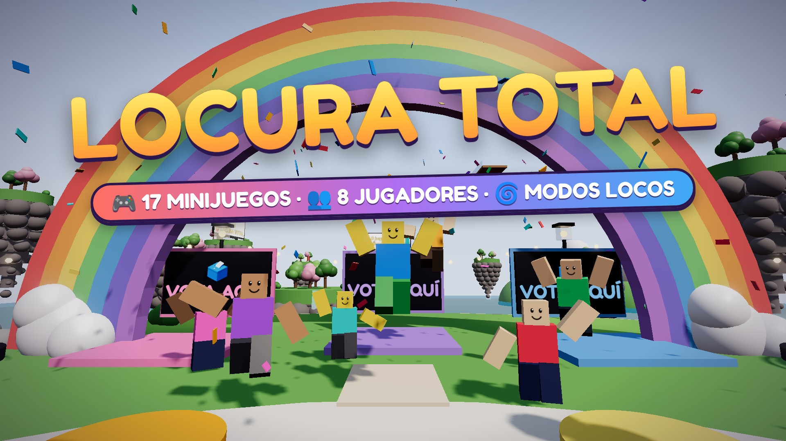

# 🚀 Publicar LOCURA TOTAL en Roblox

## Título

**🤪 LOCURA TOTAL [17 MINIJUEGOS]**

(Otras opciones: `LOCURA TOTAL 🎉 Minijuegos con Amigos` · `🤪 Locura Total: Party de Minijuegos`)

## Descripción (cópiala tal cual)

```
🤪 ¡La fiesta de minijuegos más loca de Roblox! Hasta 8 jugadores votan el minijuego, una ruleta elige un MODO LOCO… ¡y a sobrevivir!

🎮 17 MINIJUEGOS: Suelo que Cae, Lluvia de Meteoritos, Patata Bomba, Sillas Musicales, Invasión Zombi, Guerra de Bolas de Nieve, Color Loco, La Licuadora, Carrera Loca ¡y muchos más!
🌀 12 MODOS LOCOS: gravedad lunar, gigantes, todo de hielo, noche disco, gravedad que cambia sola… ¡o CAOS TOTAL!
🔨 Martillo Loco, cajas sorpresa ❓ con poderes y un botón rojo que NO debes pulsar 🔴
👑 Gana rondas, sube al podio y consigue coronas. Tus coronas, victorias y nivel se guardan.
🏝️ Explora el lobby: trampolines, cañón humano e isla secreta.

👥 ¡Mejor con amigos! Invítalos y que gane el más loco.
```

## Imágenes

| | Archivo | Dónde va |
|---|---|---|
| 🖼️ | [`imagenes/portada.jpg`](imagenes/portada.jpg) (1920×1080) | Miniatura (*Thumbnail*) |
| 🟨 | [`imagenes/icono.png`](imagenes/icono.png) (512×512) | Icono del juego |



## Dónde se pone todo

1. En Roblox Studio: *File → Publish to Roblox* (si aún no lo has publicado).
2. Ve a [create.roblox.com](https://create.roblox.com) → **Creations** → tu experiencia.
3. **Configure → Basic Info**: pega el **título** y la **descripción**. Género: *Party & Casual*.
4. **Configure → Places → (tu lugar) → Server Size**: pon **8**.
5. **Icon and Thumbnails** (en *Basic Info*): sube `icono.png` como icono y `portada.jpg` como miniatura.
6. Guarda y ponlo **público** (*Permissions / Privacy*).
